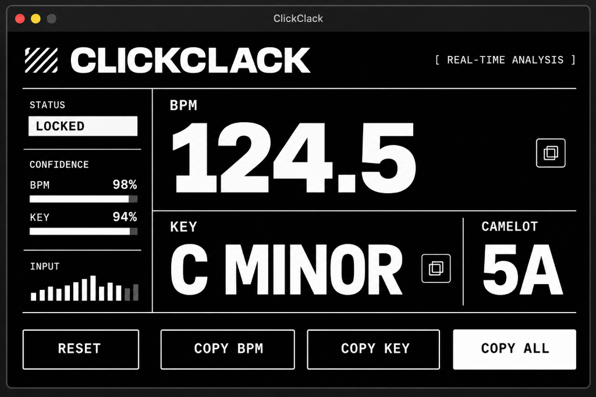

# /// CLICKCLACK

<div align="center">

```
   ___ _     ___ ___ _  ______ _      _   ___ _  __
  / __| |   |_ _/ __| |/ / ___| |    /_\ / __| |/ /
 | (__| |__  | | (__| ' < (__ | |__ / _ \ (__| ' < 
  \___|____|___|\___|_|\_\___|____/_/ \_\___|_|\_\
```

**Профессиональный Real-Time детектор BPM и музыкальной тональности (Key) для macOS Apple Silicon**  
*Разработан специально для Ableton Live 11 & 12, Logic Pro и FL Studio.*

[-black?style=for-the-badge&logo=apple)](https://github.com/ku1on/ClickClack)
[](https://github.com/ku1on/ClickClack/releases)
[](https://github.com/ku1on/ClickClack)
[](LICENSE)

<br/>



</div>

---

## ☕ Поддержать проект (Pay What You Want / Чаевые)

ClickClack распространяется по модели **Pay What You Want («Плати сколько хочешь»)** — вы можете скачать и пользоваться плагином **абсолютно бесплатно**, а если он экономит вам время в студии и помогает в творчестве — закинуть автору любую комфортную сумму на кофе или дальнейшую разработку версии под Windows:

* 💳 **Чаевые картами РФ / СБП (CloudTips / Т-Банк):** [Оставить чаевые](https://pay.tbank.ru/) *(или CloudTips)*
* 🚀 **Boosty (Донат / Подписка):** [boosty.to/clickclack](https://boosty.to/)
* 🌍 **Gumroad (Зарубежные карты / Apple Pay / PayPal):** [gumroad.com](https://gumroad.com/)
* 💎 **USDT (TRC20):** `Укажите свой кошелек в настройках релиза`
* ⚡ **TON:** `Укажите свой TON адрес`

---

## ⚡ О плагине

**ClickClack** — минималистичный, бескомпромиссный инструмент для мгновенного определения темпа и тональности трека или сэмпла прямо во время воспроизведения в DAW. 

Никаких облачных запросов, телеметрии, подписок или перегруженных меню. Вся обработка происходит **100% локально** на мощностях Apple Silicon с использованием алгоритмов мирового стандарта **Essentia MIR** и аудиодвижка **JUCE 8**.

---

## 🎯 Ключевые возможности

### 1. Точный BPM без скачков и дребезга
* **Окно накопления 5–8 секунд:** плагин не показывает случайные промежуточные цифры — он накапливает автокорреляционную статистику и выдает только проверенный темп.
* **Умное квантование к музыкальной сетке:** алгоритм распознает фазовый джиттер и автоматически притягивает погрешности вида `144.6`–`144.8` к честным **`145.0 BPM`**. Поддерживаются также половинные сетки (`.5`).
* **Интеллектуальная фиксация (`LOCKED`):** гистерезис требует устойчивого консенсуса нескольких фреймов перед фиксацией, предотвращая скачки от сбивок и дропов.

### 2. Определение тональности и Camelot Wheel
* **Гармонический профиль HPCP:** спектральный анализ хромы по 12 мажорным и 12 минорным профилям.
* **Нотация Camelot:** мгновенный перевод в формат для гармонического сведения (`5A` = C Minor, `8B` = C Major, `8A` = A Minor и т.д.).
* **Защита от перкуссии:** фильтрация резких транзиентов бочки и малого барабана, чтобы аккордовая информация считывалась без ложных модуляций.

### 3. Real-Time безопасность
* **Wait-Free Lock-Free FIFO:** в аудиопотоке (`processBlock`) нет блокирующих мьютексов и динамических выделений памяти. Плагин никогда не вызовет щелчков, дропаутов или зависания звука в Ableton.
* **Апсемплинг/Даунсемплинг SINC:** встроенная поддержка любых частот дискретизации проекта (44.1k, 48k, 88.2k, 96k, 192k) с ресемплингом через `libsamplerate`.

### 4. Швейцарский бруталистский интерфейс
* Монохромная эстетика, четкая типографика Apple SF Pro, высокая контрастность и моноширинные технические цифры.
* 12-сегментный ступенчатый индикатор входного сигнала.
* Кнопки быстрого копирования в один клик:
  * `COPY BPM` — копирует только темп.
  * `COPY KEY` — копирует тональность.
  * `COPY ALL` — копирует готовую строку метаданных: `124.5 BPM | C Minor | 5A`.

---

## 📦 Быстрая установка (Готовый релиз)

### Вариант 1: Через архив релиза (самый быстрый)
1. Перейдите в раздел **[Releases](https://github.com/ku1on/ClickClack/releases)**.
2. Скачайте архив **`ClickClack-macOS-arm64-v1.0.0.zip`**.
3. Распакуйте архив и запустите двойным кликом скрипт установки `install.sh` (или выполните команду в терминале):
   ```bash
   ./install.sh
   ```
4. Скрипт сам скопирует VST3 в `~/Library/Audio/Plug-Ins/VST3`, Audio Unit в `~/Library/Audio/Plug-Ins/Components`, приложение в `/Applications` и сбросит кэш macOS CoreAudio.

### Вариант 2: Ручная установка
* Скопируйте **`ClickClack.vst3`** в папку:
  `~/Library/Audio/Plug-Ins/VST3/` (или `/Library/Audio/Plug-Ins/VST3/`)
* Скопируйте **`ClickClack.component`** в папку:
  `~/Library/Audio/Plug-Ins/Components/` (или `/Library/Audio/Plug-Ins/Components/`)
* Снимите карантин macOS (если система ругается при первом запуске):
  ```bash
  xattr -cr ~/Library/Audio/Plug-Ins/VST3/ClickClack.vst3 ~/Library/Audio/Plug-Ins/Components/ClickClack.component
  ```

---

## 🎛 Работа в Ableton Live 11 / 12

1. Откройте **Ableton Live**.
2. В браузере слева откройте **Plug-Ins** → **VST3** (или **Audio Units**) → **ClickClack Audio** → **ClickClack**.
3. Перетащите плагин на аудиодорожку или на Master-канал.
4. Нажмите Play в Ableton.
5. Первые 5 секунд в статусе отображается `ANALYZING xx%`, затем плагин переходит в статус **`LOCKED`** и выводит чистые значения BPM и тональности.

> 💡 **Совет:** Если Ableton Live был открыт во время установки плагина, перезапустите Ableton либо откройте **Settings (Preferences) → Plug-Ins**, зажмите клавишу **Option (Alt)** на клавиатуре и нажмите **Rescan** (принудительное глубокое пересканирование).

---

## 🛠 Сборка из исходников

Для разработчиков, желающих собрать проект самостоятельно под macOS Apple Silicon (ARM64):

### Системные требования:
* macOS 12.0+ (Apple Silicon M1/M2/M3/M4)
* Xcode Command Line Tools (`clang`, `make`)
* CMake 3.22+
* Зависимости Homebrew:
  ```bash
  brew install libsamplerate fftw libyaml taglib eigen ffmpeg
  ```

### Сборка:
```bash
# 1. Клонируйте репозиторий
git clone https://github.com/ku1on/ClickClack.git
cd ClickClack

# 2. Запустите сборку
./Scripts/build.sh

# 3. Установите в систему
./Scripts/install.sh
```

---

## 📂 Структура проекта

```text
ClickClack/
├── CMakeLists.txt                # Главная конфигурация сборки CMake
├── LICENSE                       # Лицензия GNU AGPLv3
├── README.md                     # Документация продукта
├── Assets/                       # Изображения интерфейса
├── Scripts/
│   ├── build.sh                  # Автоматическая сборка Release
│   └── install.sh                # Установка плагинов в систему
├── Source/
│   ├── Analysis/                 # Фоновый воркер и расчет уверенности (Confidence)
│   ├── Audio/                    # Lock-free буферы и сведение каналов
│   ├── DSP/                      # Алгоритмы Essentia, BPM Detector, Key Detector
│   ├── UI/                       # Бруталистская дизайн-система и компоненты
│   └── PluginProcessor.cpp / .h  # JUCE Audio Engine
└── deps/
    ├── JUCE/                     # JUCE 8 framework
    └── essentia/                 # Статическая библиотека Essentia ARM64
```

---

## ⚖️ Лицензия

Проект распространяется под свободной лицензией **GNU Affero General Public License v3.0 (AGPLv3)** в соответствии с лицензией библиотеки Essentia (Music Technology Group, Universitat Pompeu Fabra).

---

<div align="center">
Сделано с вниманием к звуку, деталям и швейцарской типографике.  
<b>ClickClack Audio</b>
</div>
